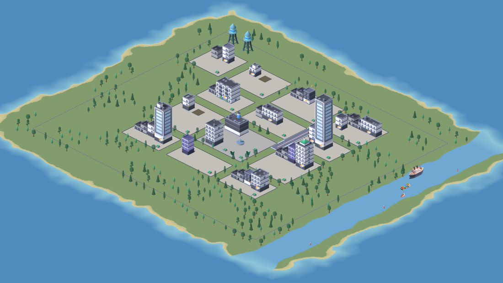

# Botropolis

Every Claude Code session on this machine, drawn as a city.
Districts are projects, buildings are sessions, and everything on the map means one thing you can read by hovering it.




## Start here

```
systemctl --user enable --now botropolisd   # the daemon: inotify on ~/.claude plus hook pushes, on a unix socket
botropolis install-hooks                    # botropolis-hook into ~/.claude/settings.json (backup kept)
botropolis doctor                           # the daemon, the hooks, a terminal, the claude CLI, the display
botropolis                                  # the city
botropolis find -n 5 "words"                # sessions by what was said in them, daemon or not
botropolis find                             # the finder, in the open city; bind it to a key (see --help)
```

Then one line in your shell's startup file:

| shell | file | line |
| --- | --- | --- |
| bash | `~/.bashrc` | `eval "$(botropolis shell-init bash)"` |
| zsh, the default on macOS | `~/.zshrc` | `eval "$(botropolis shell-init zsh)"` |
| fish | `~/.config/fish/config.fish` | `botropolis shell-init fish \| source` |

`botropolis shell-init` names no install path, so the line is the same on every system and from every package.
Those three are tested on Linux and on macOS's own bash and zsh; for any other shell, `botropolis new "$PWD"` and `claude attach` are what the integration runs, and an issue asking for yours is welcome.
Older setups that source `/usr/share/botropolis/botropolis.bash` keep working.

Every package also installs completion for those three shells, so `botropolis attach <Tab>` offers the running sessions by title.
bash completion needs the bash-completion package, which most Linux desktops have; on a Mac, `brew install bash-completion`.
From a source build, `botropolis completion bash|zsh|fish` prints the script.

That line is the one that changes how you work.
Every session becomes a `claude --bg` job you can close, reopen, park and wake from the map, and the terminal is only ever a view of it.

Sessions live in Claude Code's own background daemon;
Botropolis starts them, opens them in a terminal, parks them and wakes them, and never writes to `~/.claude` itself.

## What you see

One district per project, one building per session, and every object stands for one datum.
A building's height is its context window used and its beacon is its state — needs-you amber, working blue, waiting teal, unattended violet, resting slate.
While a session is mid-turn its roof is scaffolded with work lights, and each tool call runs a load up a hoist on the building's corner.
A drone works on the building for each subagent in flight and flies to the project it works in, and smoke rises per API error.
A flag flies per PR, an inspector's car parks outside while one is open, and a merge sends a truck off the island by the bridge.
Each message one session sends another drives a van along the road between their projects.
A vacant plot is a session nothing has been typed into yet: never counted, and `botropolis rm --older-than` clears it after an hour.

The plant on the plaza is the API — click it for the breakdown by model, project and session over an hour, a day or a week.
The towers on the ridge are MCP servers, the library ranks skills, and the city hall carries Claude Code's own rollup.
A stopped session stays on its own lot: resting, then shuttered after a week of quiet and overgrown after a month, and its card says how long it has been quiet.
Nothing leaves the map on a timer.
Avenues carry traffic between projects whose sessions message each other or edit each other's files.
The wires from the plant carry each session's live token rate;
a session with no wire is one the daemon has seen no hook events from, so it is reading files.
The freight loop round the city is the ledger: one train per model, a wagon per unit of the day's tokens.
A new session arrives on a tug up the river and its building rises once it docks;
one you demolish leaves downriver.

The strip along the top is the city's tallies and the sidebar (`b`) is the same thing as a list.
The timeline (`t`) is the daemon's event log, so it survives the window closing:
when the city opens or comes back into focus, "while you were away" lists what needed you or went wrong since it was last seen.

A building's card has a **summary** button (`i` from the keyboard).
It shows the recap Claude Code writes at the foot of a session left waiting, with how old it is and how many turns the session has taken since.
A session with no recap shows its last prompt instead,
and a **generate summary** button that asks your own `claude` CLI for one.
That is the only thing on the map that spends tokens, and only when you press it:
it runs Haiku with no tools, no MCP servers and no hooks, writes no transcript, and never appears in the city as a session.

Keys: drag to pan, wheel to zoom (one notch out past Skyline is the City Plan, a flat map of every district; `m` opens it from anywhere), `r` to turn, `f` for Skyline, `tab` for the next session that needs you, `enter` to attach it, `i` its summary,
`c` for a new session here, `d d` to demolish, `b` sidebar, `x` breakdown, `t` timeline, `/` or `ctrl+k` find, `s` settings, `n` night/day/live, `[` `]` scrub the clock,
`h` hide the UI, `p` save a frame, `?` all of them.

## Installing

Packages for each release are on the [releases page](https://github.com/Botropolis-City/botropolis/releases), built by CI from the commit they are tagged at.

On Arch, install [botropolis](https://aur.archlinux.org/packages/botropolis) (built from source) or [botropolis-bin](https://aur.archlinux.org/packages/botropolis-bin) (the release binaries) from the AUR, with `makepkg` or your AUR helper of choice, e.g. `paru -S botropolis` or `yay -S botropolis`.

On Debian and Ubuntu, add the repository once and `apt upgrade` keeps it current:

```
sudo install -d /etc/apt/keyrings
sudo curl -fsSLo /etc/apt/keyrings/botropolis.asc https://pkg.botropolis.city/botropolis.asc
sudo curl -fsSLo /etc/apt/sources.list.d/botropolis.sources https://pkg.botropolis.city/botropolis.sources
sudo apt update && sudo apt install botropolis
```

On Fedora, RHEL and their relatives, the same for `dnf upgrade`; on openSUSE, put the file in `/etc/zypp/repos.d/` and use `zypper`:

```
sudo curl -fsSLo /etc/yum.repos.d/botropolis.repo https://pkg.botropolis.city/botropolis.repo
sudo dnf install botropolis
```

On macOS, Apple silicon or Intel, add the tap once and `brew upgrade` keeps it current; `brew services` runs the daemon:

```
brew tap botropolis-city/botropolis https://pkg.botropolis.city/brew
brew install botropolis-city/botropolis/botropolis
brew services start botropolis
```

The formula builds from the release's source, so it needs nothing signed and pulls in Go only to build.

The APT and RPM repositories are signed by the key at [pkg.botropolis.city/botropolis.asc](https://pkg.botropolis.city/botropolis.asc), fingerprint `2AA4 7C51 3C0D 0C9E 7F0F  8769 956D 666C 68C8 E0E4`, and the APT source trusts it for this repository only.

To install once without adding a repository, the newest packages are always at `https://github.com/Botropolis-City/botropolis/releases/latest/download/` as `botropolis_amd64.deb`, `botropolis_arm64.deb`, `botropolis.x86_64.rpm` and `botropolis.aarch64.rpm`.

```
botropolis --version    # should print the version you installed
```

`go install botropolis.city/botropolis/cmd/...@latest` builds the three binaries from source, without the units, desktop entry or shell integration.

Every package installs the three binaries, both systemd user units, the desktop entry and icon, the shell integration, and the licences for the artwork and the typeface that are compiled in.
`SHA256SUMS` is published beside them.

There is also a plain tarball if you would rather not install anything, and `make build` puts the three binaries in `bin/` from a checkout.

## Running it

The package installs `botropolis.desktop`, so the city is in your launcher under "Botropolis".

`botropolis setup` finishes an install: it registers the hooks, starts the daemon, and prints the line for your shell's startup file.
`botropolis` opens the city, and `botropolis --help` lists the rest, grouped.
`new <dir> [prompt]`, `attach <id>`, `stop <id>` and `rm <id>` wrap the `claude` CLI, so you never need to type `claude` yourself;
`attach` attaches in the terminal you are in and resumes a resting session first, and `rm --older-than 168h` clears the old ones.
`status` prints the table and `status --live` keeps it open, `events --since 2h` prints the daemon's log, and `setup --remove` takes the hooks out again.
`--set key=value` sets any config key for one run.

`p` in the city saves the frame as a PNG.
To post your city somewhere, `shift+s` shares it first: names, prompts, spend and token figures are hidden, and every panel with them.
Then `p` saves a picture, `g` a four-second GIF, and `c` a clip (`l` picks 5 to 60 seconds) to your Pictures and Videos folders.
A clip needs ffmpeg, and the city says so when it is missing.
For frames from a checkout, `make build-dev` builds the binaries with the frame tooling, which release builds leave out:
`bin/botropolis city --screenshot city.png` renders one frame and exits;
`--headless` runs it on a virtual display so no window opens, `--keys n,n,x` presses keys first, and `--record dir --seconds 24` writes frames for a GIF (`make gif`).
`--window 1920x1080` sizes the window and `--fps 30` records smoother frames.
Media for the website is filmed from recorded demo sessions rather than anyone's real ones: see [demo/](demo/README.md).

Settings live in `~/.config/botropolis/config.toml` (or `.yaml` or `.json`), and `s` in the city opens a settings panel that writes it back.
Any key can be set for one run with `--set key=value`, or with its environment variable, such as `BOTROPOLIS_TERMINAL` for `terminal`.
`man botropolis-config` lists every key with its default, and `man botropolis` and `man botropolis-<command>` cover the commands.

[docs/compatibility.md](docs/compatibility.md) says which of these, and which of `status --json`, `bar` and the packages, 1.0.0 promises not to break.

A waybar module, for example:

```json
"custom/botropolis": { "exec": "botropolis bar --watch", "return-type": "json", "on-click": "botropolis" }
```

See [DESIGN.md](DESIGN.md) for the design and the rules, [ROADMAP.md](https://github.com/Botropolis-City/meta/blob/main/ROADMAP.md) in the Botropolis-City meta repository for where it is going,
and [docs/usage-profile.md](docs/usage-profile.md) for the numbers it is built around.

[CONTRIBUTING.md](CONTRIBUTING.md) is how the repository works, [CHANGELOG.md](CHANGELOG.md) is what changed,
[SECURITY.md](SECURITY.md) says what Botropolis touches and how to report anything exploitable,
and [CODE_OF_CONDUCT.md](CODE_OF_CONDUCT.md) applies to everyone here.
Botropolis is MIT licensed; see [LICENSE](LICENSE).

## Thanks

**Botropolis exists because of [bot-crossing](https://github.com/jarrenrocks/bot-crossing) by [Jarren Rocks](https://jarren.rocks).**
He had the idea first: that the agent sessions on your machine are a place, and that a place is easier to read at a glance than a list.
His is a 3D colony in the browser where every thread is an astronaut, and it is worth your time.
Thank you, Jarren.

Two of its ideas are kept here outright.
A **per-harness adapter seam**, so the thing that reads sessions is not welded to one vendor.
And a **sticky layout**, because a map is only useful if you can learn it, and a map that rearranges itself has taught you nothing.

Everything else is different, and the differences are choices rather than improvements:

| | bot-crossing | botropolis |
| --- | --- | --- |
| runs as | a browser app on a local HTTP server | a native binary |
| covers | Claude Code, Codex and Cursor | Claude Code only |
| a session is | a thread it reads and opens through the desktop app | a `claude --bg` job it starts, parks and wakes; terminals are views of it |
| size means | transcript bytes, on a log scale | nothing — every object stands for one datum you can hover |
| drawn with | three.js at runtime, in 3D | 2D sprites pre-rendered from 3D kits, Factorio-style |

The reason for all of it is [docs/usage-profile.md](docs/usage-profile.md).
This machine runs CLI-only, several sessions at once, with context as the scarce resource — a profile the desktop app's focus-and-unread bookkeeping never fitted.
None of that makes bot-crossing wrong;
it makes it a different program for a different desk, and it was the one that showed the idea works.

The roads, trees, cars, trains, boats and landmarks are [Kenney](https://kenney.nl)'s, from eight of the studio's 3D kits — City Kit Commercial, City Kit Roads, City Kit Industrial, City Kit Suburban, the Nature Kit, the Car Kit, the Train Kit and the Watercraft Kit, all CC0.
Every session's building, the drone, the plaza's fountain, and the skips, trucks and ruins of a building site are modelled here, in `tools/render-sprites/buildings.py` and `render.py`, in the kits' palette.
Both are pre-rendered once in Blender by `tools/render-sprites` into the atlases under `pkg/assets/kits/` (four headings, two zoom levels),
the way Factorio ships its sprites: the runtime only ever draws 2D.
The 16 px Tiny Town, Tiny Factory and Roguelike Modern City packs are still bundled, though the top-down view that drew them is no longer offered.
Thank you, Kenney; see [`pkg/assets/kenney/README.md`](pkg/assets/kenney/README.md) and [`pkg/assets/kits/README.md`](pkg/assets/kits/README.md) for the packs, versions and terms,
and [support the studio](https://kenney.nl/donate) if the work helps you too.

The chrome is set in [Inter](https://rsms.me/inter/) by The Inter Project Authors, embedded from `pkg/assets/fonts` under the SIL Open Font License 1.1
(the licence text ships beside the face).

## Not doing

Planets, orbit mode, a 3D renderer, network serving, quality presets beyond render scale and liveliness, animated faces.
Each is either bot-crossing's setting rather than a feature, or a cost the footprint principle rules out.

## Tools

`tools/analyze-history.py` summarises Claude Code usage from `~/.claude/projects`.
Read-only, stdlib only.

`tools/make-fixtures.py` copies a scrubbed slice of `~/.claude` into `testing/helpers/fixtures/<name>/home/`, laid out like a `$HOME` so tests can point the read model at it.
Ids, timestamps and `usage` are kept;
prompts, tool text, titles and account identifiers become deterministic placeholders,
and project paths, branches, PR repositories and MCP server names are renamed to stable aliases that keep their shape, their nesting and their distinctness.
A fixture is safe to share, and a frame rendered from one shows the city without showing whose it is.
Sampled fixtures are not committed, and no test reads them:
the tests run against the hand-written `testing/helpers/fixtures/synthetic/` home, and the sampler is for finding new shapes to add to it and for `make gif`.

Both take `--help`.
